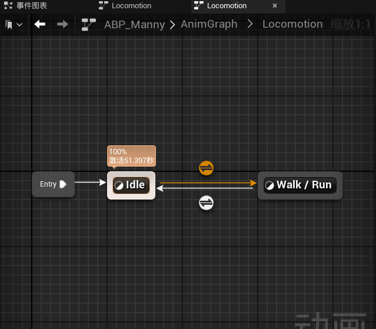
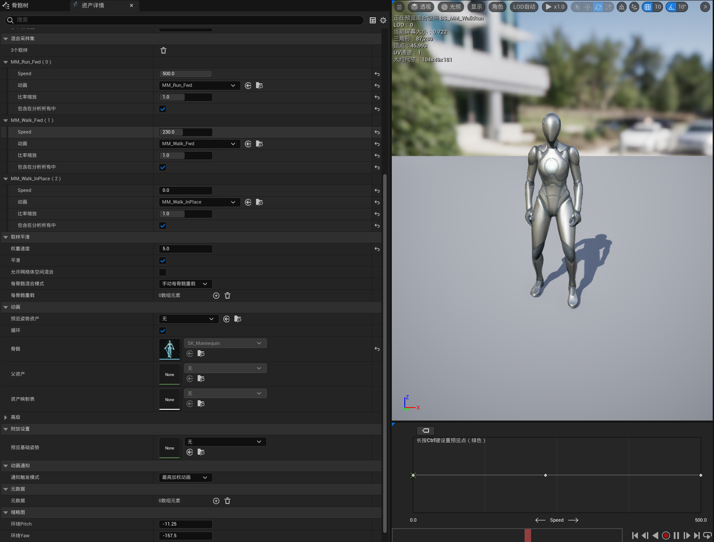

# ta-anim-demo
UE5 speed-driven locomotion demo  
根据UE 5.4.4的第三人称模板简单实现了一个更符合我心中预期的奔跑动作模型  
[▶ B站链接](https://www.bilibili.com/video/BV1DRsG6nE84/?vd_source=32bdfd35e1929cfb581609c85be8dac6)  
[⬇ 原始文件](video-demo.mp4)

## 状态机
  

## 混合空间
  

## 我改了什么
其实模板给的运动模型已经十分完善了，但在动作的选择上有点过于单一了，所以我在基础上添加了shift奔跑和ctrl缓速行走两个功能。  然后我还做了几组比对，观察调整了移动组件的部分参数，让运动变得更加符合我的预期一些，主要是让动画变得更加“慢一些”，这样我们能更加清晰地看到动作间的衔接以此保留更多动作细节。  
改变的参数有Max Acceleration来改变起步的速度，模板默认的值是1500，我尝试了500和1000，还有参数Braking Deceleration Walking以此增加停止时的“惯性感”，模板默认值是2000，我尝试了700，1000和1500，最终综合看下来我选择了500的Max Acceleration和1500的Deceleration Walking最自然，其实我还考虑过更改Rotation Rate，我尝试了将它的Yaw更改成300，我最开始想的是让转身更加慢一些，但我调整完前面的参数后感觉已经让运动变得很“重”了，再调就变得过于缓慢了，所以我维持了默认的值。  
最后其实我还尝试增加新的状态机Jog，但最终效果不是很好我就删除了。

## 数据（改前改后的奔跑动作帧数对比）
| 指标 | 改前 | 改后 |  
| 起步 | 42 帧 | 72 帧 |  
| 停止 | 22 帧 | 37 帧 |

## 项目过程中我踩过的坑
在增加Jog状态机的时候在录视频的时候，忽然发现状态在Walk状态和Jog状态之间疯狂切换，后来才发现是因为我只更改了walk到jog的速度阈值条件忘了把jog到walk的条件一起更改了xd。

## 局限
首先是我只做了向前移动的变化，没做后退和侧移。  
其次是速度只做了三档阈值，没用到连续参数。  
还有转身动画我也没做，不过我目前下一步计划做 turn-in-place 转身动画。

## 环境
UE 5.4.4
